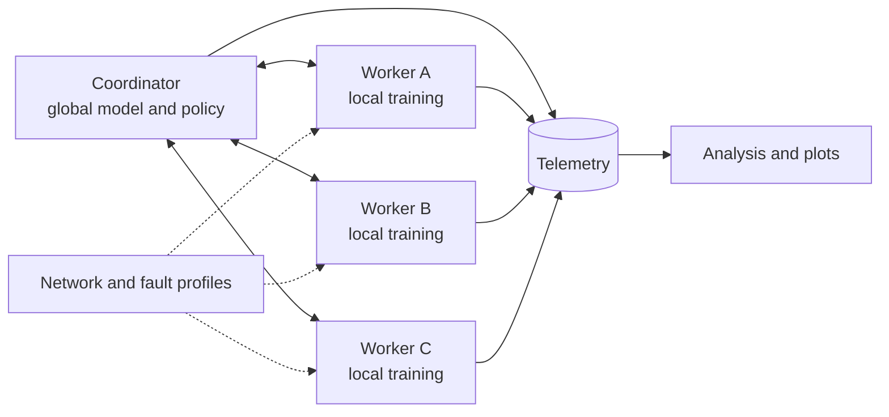

# WANTrain

WANTrain is an experimental distributed PyTorch training runtime for heterogeneous and changing compute environments.

The project studies a practical question: how should training workers synchronize when their compute speed, bandwidth, latency, and availability differ over time?

WANTrain begins as a focused research prototype for controlled experiments. Its broader goal is to identify mechanisms that could make large-scale distributed ML training and computing more useful across mixed clusters, remote accelerators, and wide-area networks.

> **Project status:** milestone 1 setup. The single-process reference path is being established before the distributed runtime.

## What WANTrain will provide

- A centralized coordinator and multiple PyTorch workers.
- Barrier-based and streaming model-update coordination.
- Fixed and adaptive local-training intervals.
- Staleness-aware update admission and weighting.
- Per-worker compute, network, and failure emulation.
- Structured telemetry for reproducible policy comparisons.
- Time-to-target accuracy as the primary outcome.

The initial workload is ResNet-18 on CIFAR-10. Keeping the model conventional makes changes in training behavior easier to attribute to the distributed system rather than to an unstable workload.

## System shape



Workers train from a versioned global-model snapshot, then return parameter deltas with their base version and telemetry. The coordinator validates and aggregates each update according to the selected coordination, scheduling, admission, and weighting policies.

WANTrain treats these as separate experimental choices. For example, local SGD is a configurable amount of local work and can operate with either a global barrier or streaming updates.

## Initial experiments

The first useful benchmark will compare:

| Policy | Coordination | Local work |
|---|---|---|
| Synchronous SGD | Barrier | One step |
| Synchronous local SGD | Barrier | Fixed multi-step interval |
| Asynchronous local SGD | Streaming | Fixed interval |
| Adaptive local SGD | Streaming | Interval selected from worker and network telemetry |

Experiments will apply repeatable WAN conditions and scheduled disruptions, such as bandwidth degradation or a temporary worker disconnect. Results will report convergence alongside communication cost, staleness, idle time, rejected work, and recovery behavior.

## Roadmap

1. Establish a reproducible single-process CIFAR-10 reference.
2. Implement a two-worker barrier runtime and versioned aggregation.
3. Add streaming updates, fixed local work, and staleness tracking.
4. Add isolated network profiles and deterministic fault injection.
5. Evaluate a simple telemetry-driven local-work scheduler.
6. Publish a reproducible v0.1 benchmark and evidence package.

Later work may explore additional workloads, dynamic coordination regimes, churn-aware scheduling, update compression, and experiments across real geographic links. Those directions will be chosen from measured v0.1 behavior rather than assumed in advance.

## Documentation

The [architecture and experimental design](docs/architecture.md) defines the v0.1 scope, protocol semantics, runtime invariants, evaluation methodology, and decisions that implementations should follow.

## Milestone 1 setup

WANTrain uses `uv` for Python environment management. Install the runtime and development dependencies with:

```bash
uv sync --extra dev
```

The core dependencies are PyTorch, TorchVision, NumPy, PyYAML, Typer, Rich, and tqdm. Development checks use pytest and Ruff.

Run the tiny CPU smoke reference:

```bash
uv run wantrain reference run --config experiments/configs/smoke_cpu.yaml
```

Run the CIFAR-10 ResNet-18 reference after dependencies are installed and CUDA is available:

```bash
uv run wantrain reference run --config experiments/configs/cifar10_resnet18_local.yaml
```

Reference runs write resolved configuration, JSONL events, and final metrics under `runs/`. CIFAR-10 data is stored under `data/`.

## License

No license has been selected yet.
