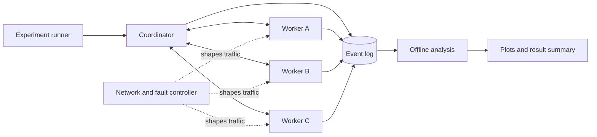
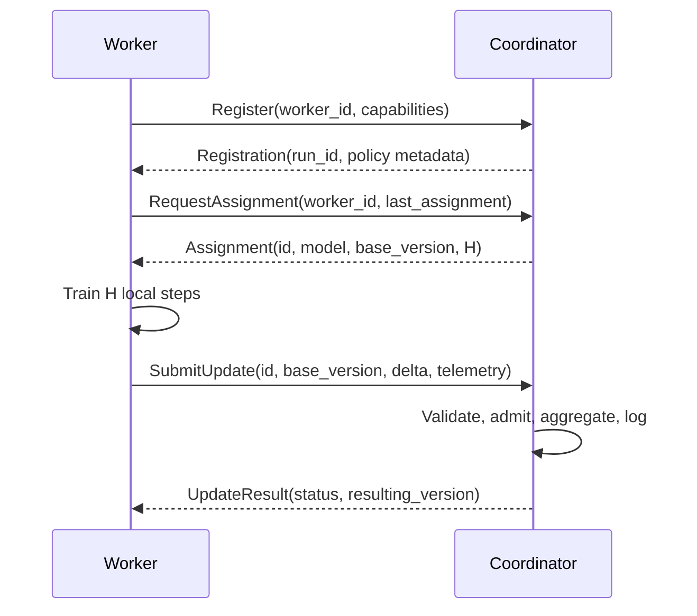

# WANTrain Architecture and Experimental Design

## 1. Purpose

WANTrain is an experimental distributed PyTorch training runtime for studying how synchronization policy affects training when workers have different and changing compute, bandwidth, latency, and availability.

The v0.1 system must make controlled comparisons reproducible. It is not expected to prove that an adaptive policy is universally better. Its job is to implement well-defined baselines, capture enough telemetry to explain their behavior, and test whether a simple adaptive synchronization policy improves time to a target model quality under selected heterogeneous conditions.

The primary research question is:

> How should distributed training workers synchronize when their compute speed, network conditions, and availability differ over time?

The primary engineering deliverable is:

> A fault-injectable distributed PyTorch training runtime that compares barrier-based and streaming aggregation with fixed and adaptive local-work intervals under controlled compute and WAN conditions.

## 2. Feasibility and project boundary

The plan is technically plausible. A centralized coordinator, a small image-classification workload, synthetic network profiles, and four policy variants form a coherent v0.1. The suggested six-week schedule is an aggressive target for roughly 30 hours of work, so each milestone below has an exit criterion and later features must not delay the smallest useful benchmark.

Three clarifications shape this design:

1. Synchronization mode and local work are separate policy axes. A run can use a barrier or streaming updates, and either can use one or many local optimizer steps per report.
2. The coordinator applies parameter deltas, not an ambiguously defined mix of gradients and models. Every update identifies the exact global model version from which local training began.
3. Network emulation must isolate worker traffic. Applying a root `tc` rule to the host's main interface is unsafe and cannot express a different profile for each colocated worker.

### 2.1 In scope for v0.1

- One coordinator and two or more workers.
- ResNet-18 training on CIFAR-10.
- A coordinator-owned canonical model and monotonically increasing global version.
- Barrier and streaming coordination modes.
- Fixed local-step intervals and one heuristic adaptive interval controller.
- Staleness measurement plus accept-all, cutoff, and decay policies.
- Reproducible static and time-varying network profiles.
- Worker pause, disconnect, and reconnect fault injection.
- Structured event telemetry and offline plots.
- Single-host experiments first; multiple hosts when available.
- CLI-driven operation and configuration files.

### 2.2 Deferred until after v0.1

- Transformer workloads.
- Peer-to-peer, ring, or decentralized aggregation.
- Elastic coordinator replication or coordinator failover.
- Kubernetes and production service discovery.
- Prometheus or a monitoring UI.
- Learned or reinforcement-learning schedulers.
- Gradient or model compression beyond an optional transport optimization.
- Byzantine-worker defenses, privacy guarantees, or secure aggregation.
- A C++ data path unless profiling identifies it as a meaningful bottleneck.
- Claims about production readiness or universal convergence improvements.

## 3. Design principles

- **Experimental validity before feature count.** Each result must identify the code version, configuration, seeds, dataset split, policy, and environment.
- **One canonical owner of state.** In v0.1, the coordinator alone commits global model versions.
- **Explicit semantics.** Messages carry version, sample count, local-step count, and policy metadata; behavior must not depend on arrival timing that is absent from logs.
- **Separate mechanisms from policies.** Transport moves messages, aggregation combines updates, admission decides whether an update is useful, and scheduling chooses local work.
- **Keep the workload ordinary.** ResNet-18 and CIFAR-10 reduce uncertainty in the systems comparison.
- **Optimize measured training progress.** Throughput and utilization are diagnostic metrics. Time to a predefined validation target is the primary outcome.
- **Prefer reproducible emulation.** Real geographic experiments validate conclusions later but do not replace controlled profiles.

## 4. System context



The experiment runner resolves one configuration, assigns a run identifier, launches or supplies launch instructions for all processes, and records run metadata. It is control tooling rather than part of the training protocol.

The coordinator owns the global model, global version, worker registry, aggregation state, validation schedule, and server-side policy state. Workers own their local model and optimizer while processing an assignment. The network and fault controller applies a predefined timeline independently of the training logic.

## 5. Conceptual policy model

WANTrain represents a training protocol as four independent choices:

| Axis | Initial options | Meaning |
|---|---|---|
| Coordination | `barrier`, `streaming` | Whether a commit waits for a round cohort or occurs as updates arrive |
| Local-work interval | `fixed`, `adaptive` | How the worker's requested local-step count is selected |
| Admission | `accept_all`, `max_staleness` | Whether a received update may be applied |
| Weighting | `sample`, `staleness_decay` | How much an admitted update contributes |

This avoids treating local SGD as a third coordination protocol. Local SGD means that a worker performs `H > 1` local optimizer steps between reports; it can be evaluated with either coordination mode.

### 5.1 Required v0.1 comparisons

The minimum useful benchmark contains:

| Name | Coordination | Local steps | Admission/weighting |
|---|---|---:|---|
| `sync_sgd` | barrier | `H = 1` | sample weighted |
| `sync_local` | barrier | fixed `H > 1` | sample weighted |
| `async_local` | streaming | fixed `H` | accept all, sample weighted |
| `adaptive_local` | streaming | adaptive `H_i(t)` | configured staleness policy |

Additional staleness policies should be compared only after these four paths are correct. Experiments must use the same initial model, data partition, validation set, and environment timeline when making a paired comparison.

## 6. Component responsibilities

### 6.1 Coordinator

The coordinator:

- initializes the canonical model and global version `0`;
- registers workers and maintains liveness information;
- assigns a model snapshot, base version, local-work budget, and assignment identifier;
- validates update metadata and tensor compatibility;
- calculates staleness at receive time;
- admits, rejects, or weights an update according to configuration;
- commits a new canonical model and increments the global version;
- creates consistent validation snapshots;
- emits events for assignments, updates, commits, validation, and failures;
- provides shutdown and final-checkpoint behavior.

The coordinator must not silently reinterpret an update. Invalid identifiers, shapes, dtypes, versions, or non-finite tensor values produce a rejection event with a reason.

### 6.2 Worker

A worker:

1. registers its stable worker identifier and capabilities;
2. requests or receives an assignment;
3. loads the assigned model snapshot as both `base_model` and `local_model`;
4. restores or retains local optimizer state according to the configured optimizer-state policy;
5. runs the assigned number of local optimizer steps;
6. computes `delta = local_model - base_model`;
7. reports the delta, assignment metadata, sample count, and telemetry;
8. waits for the next assignment or immediately requests it, depending on coordination mode.

Workers do not assign global versions. A reconnecting worker discards incomplete work unless its assignment is still explicitly accepted by the coordinator.

### 6.3 Aggregator

The aggregator is a pure policy component over validated update records and a canonical parameter snapshot. It must be testable without RPC or GPUs.

For a barrier round with updates `i = 1..n`, the default aggregate delta is weighted by processed examples:

```text
weight_i = samples_i / sum(samples_j)
aggregate_delta = sum(weight_i * delta_i)
new_model = base_model + server_lr * aggregate_delta
```

All updates in a barrier commit must share the round's base version. Duplicate updates from the same assignment are ignored idempotently.

For streaming mode, each admitted update is applied atomically to the current model:

```text
staleness_i = current_version - base_version_i
effective_weight_i = server_lr * sample_weight_i * staleness_weight(staleness_i)
new_model = current_model + effective_weight_i * delta_i
```

`sample_weight_i` must be explicitly configured for streaming runs because no natural simultaneous cohort exists. The initial default is `1.0`; it must not be inferred from an incomplete future cohort. `server_lr` is a separately recorded experimental parameter.

Parameter deltas computed after multiple local optimizer steps are model updates, not gradients. Documentation, telemetry, and code should use `update` or `delta` consistently.

### 6.4 Admission and staleness weighting

For an update based on version `b` received while the canonical version is `v`:

```text
staleness = v - b
```

Negative staleness indicates an invalid update. Initial policies are:

```text
accept_all:             accept every valid update
max_staleness(k):       accept only when staleness <= k
inverse_decay(alpha):   weight = 1 / (1 + alpha * staleness)
```

A rejected update never advances the global version. Both rejected and down-weighted updates are logged. Policy comparisons must report the amount of worker computation spent on rejected work.

### 6.5 Local-work scheduler

The scheduler returns an integer local-step budget for each assignment:

```text
H_i(t) in [H_min, H_max]
```

Its inputs are smoothed measurements available before the assignment is issued:

- worker examples per second;
- compute time per local step;
- serialization and communication time per report;
- observed round-trip time and effective throughput;
- recent update staleness;
- recent rejected-update rate.

The initial heuristic aims to amortize communication while bounding how long a worker trains on one snapshot. A suitable first controller is:

```text
raw_H_i = H_base
          * (throughput_i / median_throughput)
          * (1 + alpha * comm_time_i / max(compute_time_i, epsilon))

H_i = clip(round(raw_H_i * staleness_penalty_i), H_min, H_max)
```

The staleness penalty is at most `1` and decreases when recent staleness or rejection rate exceeds configured targets. Inputs use an exponentially weighted moving average and the controller changes `H` by at most a configured factor per assignment to prevent oscillation.

This heuristic is a hypothesis, not a guaranteed optimizer. In particular, giving a fast worker more local steps can reduce report frequency but can also increase model drift. Every adaptive run must log the selected `H`, its inputs, and the reason for changes so this behavior can be diagnosed.

### 6.6 Transport

The initial transport is gRPC with Protobuf envelopes. Model payloads are byte streams accompanied by explicit tensor metadata or a safe tensor serialization format. Do not deserialize arbitrary Python pickles received over the network.

ResNet-18 parameters are much larger than gRPC's common default message limit, so transport must use one of these deliberate approaches:

- client/server streaming with fixed-size chunks, preferred for v0.1; or
- configured message limits with a documented maximum payload size.

Every logical payload carries a checksum. The receiver assembles and validates the complete payload before handing it to the coordinator or worker. Retries use stable assignment and update identifiers so delivery is idempotent.

Authentication and encryption may be omitted for isolated single-host experiments. Any real cross-site run must use authenticated encrypted transport or a trusted encrypted tunnel; the public internet must not expose an unauthenticated coordinator.

### 6.7 Telemetry and analysis

Processes emit append-only structured events, initially JSON Lines. A post-processing command may convert events to Parquet or SQLite for analysis. All event records include:

```text
schema_version
run_id
event_id
event_type
process_role
process_id
worker_id (when applicable)
wall_time_utc
monotonic_time_ns
```

Worker/update events additionally record:

```text
assignment_id
base_version
observed_global_version
staleness
local_steps_requested
local_steps_completed
samples_processed
compute_ms
serialization_ms
rpc_ms
bytes_sent
bytes_received
training_loss
update_norm
selected_H
```

Coordinator events additionally record:

```text
global_version
active_workers
updates_received
updates_applied
updates_rejected
effective_update_weight
validation_loss
validation_accuracy
checkpoint_id
```

Counters may also be maintained, but analysis must be reconstructable from event records. Training loss and validation metrics must be labeled distinctly.

## 7. Protocol behavior

### 7.1 Registration and assignment



An assignment ID is unique within a run. Submitting the same completed assignment more than once returns the prior result and never applies the delta twice.

### 7.2 Barrier mode

The coordinator creates a round with a fixed cohort and deadline, sends the same base version to each member, and waits. The default strict baseline commits only after every cohort member returns. A timeout policy may abort the run or commit a configured quorum, but that policy is a separate named experiment and must not be silently enabled.

After a commit, all active cohort workers receive the next canonical snapshot. Worker failure under strict barrier mode demonstrates the expected availability limitation and should terminate with a clear reason rather than hang indefinitely.

### 7.3 Streaming mode

There is no global barrier. After an update is received, the coordinator evaluates and, if accepted, atomically applies it and advances the version. The worker then receives an assignment based on a current snapshot.

Concurrent arrivals are serialized at the model-commit boundary. This makes the order of committed updates explicit and reproducible from the event log, though repeated runs may still have different arrival orders.

### 7.4 Validation and checkpoints

Validation runs against an immutable model snapshot associated with one global version. It must not block update receipt longer than necessary; copying or checkpointing the snapshot can precede validation. Only coordinator-produced validation metrics determine time to target accuracy.

Checkpoint metadata includes the global version, model parameters, coordinator policy state, resolved configuration, RNG states where practical, and event-log position. Optimizer-state behavior must be chosen and recorded:

- By default, each worker retains its optimizer state across assignments while replacing model parameters with the assigned global snapshot. This preserves momentum across `H = 1` assignments and matches the intended continuous training baseline.
- A restarted worker restores its own checkpointed optimizer state when available. Otherwise it initializes new optimizer state and emits an `optimizer_state_reset` event.
- Reset-on-assignment is an explicit comparison policy, not the default, because it would discard momentum at every synchronization.

Global coordinator checkpoints alone are sufficient for saving a model artifact but do not promise exact interruption recovery. Exact run recovery also requires compatible per-worker optimizer and RNG checkpoints and is deferred until the base protocols work.

## 8. Data partitioning and model reproducibility

The experiment configuration defines:

- dataset version and checksum;
- training, validation, and test split seeds;
- per-worker partition mapping;
- IID or non-IID partition strategy;
- model initialization seed;
- data-loader and augmentation seeds;
- optimizer and learning-rate schedule;
- batch size and local-step semantics;
- deterministic-algorithm settings and known nondeterministic operations.

The first comparison uses a fixed IID partition with equal example counts. Non-IID data is a separate experiment because it changes the interpretation of model divergence and staleness. The test set is reserved for final reporting and must not drive scheduler choices.

Exact bitwise reproducibility across different GPU types is not assumed. The target is configuration reproducibility, event traceability, and repeated trials sufficient to show variability.

## 9. Network and failure emulation

Each colocated worker runs in its own container or Linux network namespace connected through a virtual interface. Traffic shaping is applied to the worker-specific interface. `netem` provides delay, jitter, reordering, and loss; `tbf` or `htb` provides rate limiting. Commands and cleanup are generated from a versioned profile rather than typed manually against the host interface.

Delay settings must state whether they represent one-way delay or target RTT. When symmetric `netem` delay is applied at both ends, measured RTT will include both directions and processing overhead. Each run performs a short probe and records observed RTT and throughput instead of assuming configured values were achieved.

Initial named profiles are starting points that require calibration:

| Profile | Target RTT | Target bandwidth | Loss |
|---|---:|---:|---:|
| `lan` | 1 ms | 1 Gbit/s | 0% |
| `good_wan` | 30 ms | 500 Mbit/s | 0% |
| `typical_wan` | 80 ms | 100 Mbit/s | 0.1% |
| `bad_wan` | 150 ms | 20 Mbit/s | 1% |

Time-varying profiles are timelines of absolute conditions, for example:

```yaml
events:
  - at: 0s
    worker: worker-b
    bandwidth_mbps: 100
  - at: 15m
    worker: worker-b
    bandwidth_mbps: 10
  - at: 25m
    worker: worker-c
    state: paused
  - at: 28m
    worker: worker-c
    state: running
  - at: 35m
    worker: worker-b
    bandwidth_mbps: 100
```

The controller logs requested and observed transitions. Fault injection supports process pause, disconnect, termination, and restart as distinct events. Random churn is deferred until deterministic timelines work reliably.

## 10. Metrics and evaluation methodology

### 10.1 Primary metric

For a validation accuracy target `A`:

```text
T_A = earliest elapsed training time at which validation_accuracy >= A
```

The target is fixed before comparing policies and chosen so all viable baselines can reach it. Elapsed time starts when the coordinator declares the run ready and includes training, communication, validation overhead, and policy-induced waiting. Dataset download, environment setup, and process launch are excluded and reported separately.

If a run never reaches the target within the fixed budget, report it as censored rather than assigning the budget time as if it succeeded. Also report the best validation accuracy reached within the budget.

### 10.2 Supporting metrics

- examples processed per second;
- accepted examples and updates per second;
- bytes transferred and reports per worker;
- communication-to-compute time ratio;
- worker idle and blocked time;
- staleness distribution;
- update rejection rate and wasted compute time;
- update and aggregate norms;
- validation loss and final validation accuracy;
- recovery time after a scheduled disturbance;
- selected local-step interval over time.

GPU utilization may be collected when available but is not required for correctness.

### 10.3 Comparison rules

- Use at least three repeated trials for headline results; add trials if variance obscures the effect.
- Pair trials by model seed, data partition, and disturbance timeline.
- Give each policy the same wall-clock or sample budget.
- Report median and individual-run values; include uncertainty when enough trials exist.
- Distinguish configured network conditions from measured conditions.
- Preserve failed and censored runs in the result set.
- Do not tune an adaptive policy on the same scenarios used for the final comparison without labeling those scenarios as development cases.
- Avoid broad claims from one model, one dataset, or one hardware topology.

## 11. Configuration contract

One resolved YAML configuration is the source of truth for a run. It contains at least:

```yaml
schema_version: 1
run:
  name: typical-wan-async-fixed
  seed: 1234
  max_duration: 45m
workload:
  name: cifar10_resnet18
  data_partition: iid_equal
  batch_size: 128
optimizer:
  name: sgd
  learning_rate: 0.1
  momentum: 0.9
  worker_state: persistent
protocol:
  coordination: streaming
  local_work:
    policy: fixed
    steps: 8
  admission:
    policy: accept_all
  weighting:
    policy: sample
  server_learning_rate: 1.0
validation:
  every_versions: 20
  target_accuracy: 0.80
network:
  profile: typical_wan
telemetry:
  format: jsonl
  output_dir: runs
```

The actual schema will evolve with implementation. Defaults are resolved and written into the run directory before training. Unknown keys and invalid policy combinations fail validation rather than being ignored.

## 12. Proposed repository structure

```text
WANTrain/
├── docs/
│   └── architecture.md
├── wantrain/
│   ├── cli/
│   ├── coordinator/
│   ├── worker/
│   ├── aggregation/
│   ├── admission/
│   ├── scheduler/
│   ├── transport/
│   ├── telemetry/
│   └── config/
├── workloads/
│   ├── cifar10/
│   └── transformer/          # post-v0.1
├── proto/
│   └── training.proto
├── experiments/
│   ├── configs/
│   ├── network_profiles/
│   └── scripts/
├── network/
│   └── netem/
├── analysis/
│   └── plots/
├── tests/
└── runs/                     # generated, normally ignored
```

Policy modules should depend on typed domain records, not on generated gRPC classes. The transport layer translates between wire messages and domain records. Workload code supplies model, dataset, training-step, and validation functions without importing coordinator internals.

## 13. Implementation milestones and exit criteria

The week labels are targets, not release commitments.

### Milestone 1: single-process reference

- ResNet-18 trains on the fixed CIFAR-10 split.
- Configuration and seeds are recorded.
- A validation target and time budget are established.
- Tooling uses `uv` with project metadata in `pyproject.toml`.
- CIFAR-10 data is stored under the repo-local `data/` directory.
- A tiny synthetic CPU smoke run verifies the training loop without downloading CIFAR-10.
- Reference runs write `resolved_config.yaml`, `events.jsonl`, and `metrics.json` under `runs/<run_id>/`.

### Milestone 2: barrier runtime

- One coordinator and two workers complete multiple strict barrier rounds.
- Sample-weighted aggregation matches an in-process reference on a deterministic toy model.
- Duplicate submission is idempotent.
- A worker failure ends with a bounded timeout and useful error.

### Milestone 3: streaming and fixed local work

- Streaming commits preserve a coherent version history.
- Staleness is calculated and logged correctly.
- `sync_sgd`, `sync_local`, and `async_local` complete comparable runs.
- Tensor transfer works for the full ResNet-18 payload.

### Milestone 4: controlled heterogeneity

- At least three calibrated network profiles can be applied per worker and cleaned up reliably.
- A time-varying profile produces visible, timestamped telemetry changes.
- A first paired baseline comparison can be regenerated from committed configs.

### Milestone 5: adaptive scheduler and faults

- Every adaptive decision is reconstructable from logs.
- The controller responds to a deterministic bandwidth transition.
- Pause, disconnect, and reconnect behaviors have explicit outcomes.
- Adaptive and fixed policies are compared without claiming success in advance.

### Milestone 6: v0.1 evidence package

- A fresh environment can reproduce one documented benchmark.
- Results include repeated trials, time-to-target or censoring, and supporting metrics.
- Architecture, experiment methodology, CLI usage, and known limitations are documented.
- Release artifacts do not depend on access to private HPC infrastructure.

## 14. Verification strategy

High-value automated checks are:

- aggregation math on small deterministic tensors;
- staleness and version-transition invariants;
- duplicate and out-of-order update handling;
- admission and decay boundary cases;
- scheduler bounds, smoothing, and rate limiting;
- config validation and resolved-config snapshots;
- payload chunking, checksum failure, and reassembly;
- a CPU-only two-worker end-to-end smoke run on a tiny synthetic dataset;
- event-schema validation and reconstruction of commit order.

GPU training and privileged network emulation belong in integration or experiment jobs. Unit tests must not require CIFAR-10 downloads, a GPU, or root networking privileges.

Key runtime invariants are:

```text
global_version begins at 0 and increases once per committed update/round
an assignment is applied at most once
barrier-round updates share one base version
staleness is non-negative for every valid update
rejected updates never change model state or global version
validation metrics name the exact model version evaluated
every run has one immutable resolved configuration
```

## 15. Risks and mitigations

| Risk | Consequence | Mitigation |
|---|---|---|
| Scope exceeds available time | No reproducible result | Enforce milestone exit criteria; defer UI, transformer, and production infrastructure |
| gRPC payload limits or copies dominate | Misleading network results | Stream chunks, record serialization separately, benchmark transport overhead |
| `tc` changes unrelated host traffic | Disruption and invalid profiles | Shape isolated namespace/container interfaces and provide idempotent cleanup |
| Different protocols use unfair training budgets | Invalid comparison | Pair configs and fix wall-clock or sample budgets before runs |
| Async delta scaling diverges | Apparent systems failure is optimization failure | Expose server learning rate, log norms, start on deterministic toy workloads |
| Adaptive controller oscillates | Worse convergence and unclear behavior | Smooth inputs, bound `H`, rate-limit changes, log decisions |
| Validation blocks training | Inflated or policy-dependent time | Validate immutable snapshots and account for validation overhead consistently |
| Optimizer state has undefined semantics | Non-reproducible convergence | Persist it per worker by default and log every reset or restore |
| One run produces a lucky result | Unsupported claims | Repeat paired trials and retain individual outcomes |
| Real sites cannot communicate inbound | Cross-site demo blocked | Keep v0.1 single-host capable; later use an approved VPN/tunnel or reachable relay |

## 16. Post-v0.1 decision gate

Further research should follow evidence from v0.1. Candidate directions include:

- mapping where fixed versus adaptive local work wins;
- stronger staleness-aware admission or weighting;
- switching coordination regimes during a run;
- churn-aware assignment;
- predicting update utility;
- update compression;
- a second workload with different optimization behavior;
- validation across real geographic links.

A direction should be selected because the v0.1 traces reveal a repeatable limitation or opportunity. A simple fixed policy performing as well as the adaptive policy is a valid result and should lead to analysis of the operating boundary, not to hidden metric or scenario changes.

## 17. Decisions requiring explicit revision

The following are current architectural defaults. Agents should not change them implicitly:

- centralized coordinator and canonical model;
- parameter-delta updates;
- local-step interval and coordination mode as separate axes;
- strict barrier behavior for the baseline;
- atomic sequential commits in streaming mode;
- persistent per-worker optimizer state, with every reset or restore logged;
- safe, chunked tensor transfer over gRPC;
- JSONL event telemetry and offline analysis;
- isolated per-worker network shaping;
- ResNet-18/CIFAR-10 with an IID equal partition for the first comparison;
- time to validation target as the primary metric.

When implementation evidence requires a change, update this document and record the reason in the same change as the code.
